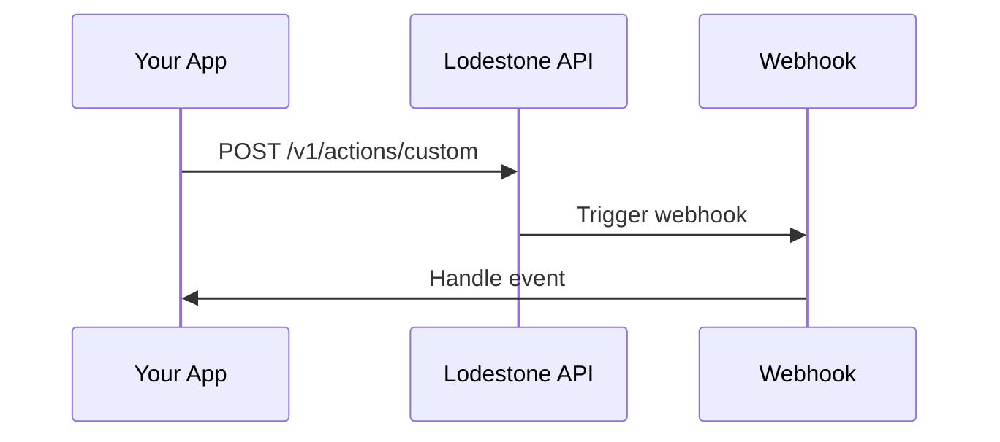

## Overview

Lodestone integrates with popular third-party tools to streamline your workflows. Use webhooks for real-time notifications, API endpoints for custom automation, and export options for data portability. This guide covers supported apps, setup instructions, and advanced configurations.

<Callout kind="info">
  All integrations require a valid API key. Generate one from your [dashboard](https://dashboard.example.com/settings/api).
</Callout>

## Supported Integrations

Connect Lodestone to your favorite tools without custom development.

<Columns cols={3}>
  <Card title="Zapier" icon="zap" href="https://zapier.com/apps/lodestone/integrations">
    Automate workflows with 5000+ apps using no-code triggers and actions.
  </Card>
  <Card title="Slack" icon="message-circle" href="/docs/slack-integration">
    Receive real-time notifications for key events in your Slack channels.
  </Card>
  <Card title="Google Sheets" icon="file-spreadsheet" href="/docs/google-sheets">
    Sync data exports directly to spreadsheets for easy analysis.
  </Card>
  <Card title="Airtable" icon="database" href="/docs/airtable">
    Mirror Lodestone records in Airtable bases for team collaboration.
  </Card>
  <Card title="Make.com" icon="play" href="https://make.com/en/integrations/lodestone">
    Build complex automations with visual scenario builders.
  </Card>
  <Card title="HubSpot" icon="users" href="/docs/hubspot">
    Sync contacts and deals for unified CRM workflows.
  </Card>
</Columns>

## Webhook Configuration

Set up webhooks to receive Lodestone events in your app.

<Steps>
  <Step title="Generate Webhook URL" icon="link">
    Navigate to Settings > Webhooks in your dashboard. Click "Create Webhook".
  </Step>
  <Step title="Configure Events" icon="bell">
    Select events like `project.updated` or `client.created`. Paste your endpoint URL.
  </Step>
  <Step title="Verify and Test" icon="check-circle">
    Send a test event. Check your logs for the payload.
  </Step>
</Steps>

Example payload:

<CodeGroup tabs="JavaScript,Python">
  ```javascript
  {
    "event": "project.updated",
    "data": {
      "id": "proj_123",
      "name": "Q4 Strategy Review",
      "status": "in_progress"
    },
    "timestamp": "2024-01-15T10:30:00Z"
  }
  ```
  ```python
  {
      "event": "project.updated",
      "data": {
          "id": "proj_123",
          "name": "Q4 Strategy Review",
          "status": "in_progress"
      },
      "timestamp": "2024-01-15T10:30:00Z"
  }
  ```
</CodeGroup>

## API Endpoints

Access Lodestone data programmatically.

<ParamField path="projects" param-type="GET" required="true">
  Retrieve all projects. Returns paginated list.
</ParamField>

<ParamField header="Authorization" param-type="string" required="true">
  Bearer `{YOUR_API_KEY}`.
</ParamField>

<ParamField query="status" param-type="string" required="false">
  Filter by `active`, `completed`, or `archived`.
</ParamField>

Example request:

<Request tabs="cURL,JavaScript">
  ```bash
  curl -X GET "https://api.example.com/v1/projects?status=active" \
    -H "Authorization: Bearer YOUR_API_KEY"
  ```
  ```javascript
  const response = await fetch('https://api.example.com/v1/projects?status=active', {
    headers: {
      'Authorization': 'Bearer YOUR_API_KEY'
    }
  });
  const projects = await response.json();
  ```
</Request>

<Response tabs="200">
  ```json
  {
    "projects": [
      {
        "id": "proj_123",
        "name": "Q4 Strategy Review",
        "status": "active"
      }
    ],
    "meta": {
      "page": 1,
      "limit": 50
    }
  }
  ```
</Response>

## Embedding and Exports

Embed Lodestone dashboards or export data in various formats.

<Tabs>
  <Tab title="Iframe Embed" icon="code">
    Embed project dashboards on your site.

    ```html
    <iframe
      src="https://dashboard.example.com/embed/projects/123"
      width="100%"
      height="600"
      frameborder="0">
    </iframe>
    ```

    <Callout kind="tip">
      Add `?theme=dark` for dark mode.
    </Callout>
  </Tab>
  <Tab title="CSV Export" icon="download">
    Export data via API or dashboard.

    <Steps>
      <Step title="API Export">
        ```
        curl -X GET "https://api.example.com/v1/projects/export?format=csv" \
          -H "Authorization: Bearer YOUR_API_KEY" \
          --output projects.csv
        ```
      </Step>
      <Step title="Dashboard">
        Go to Projects > Export > CSV.
      </Step>
    </Steps>
  </Tab>
</Tabs>

## Custom Integrations

For unsupported tools, build custom solutions.



<Expandable title="Advanced: OAuth Setup" default-open="false">
  Use OAuth 2.0 for user-authorized integrations.

  1. Redirect to `https://auth.example.com/oauth/authorize?client_id=YOUR_CLIENT_ID&redirect_uri=YOUR_URI&scope=projects:read`
  2. Exchange code for token: POST `/oauth/token`
</Expandable>

<Board title="Integration Status">
  <BoardColumn title="Live" color="2" icon="check-circle">
    <BoardCard title="Zapier" description="Core triggers and actions" icon="zap" />
    <BoardCard title="Slack" description="Event notifications" icon="message-circle" />
  </BoardColumn>
  <BoardColumn title="Beta" color="1" icon="loader">
    <BoardCard title="HubSpot Sync" description="Contact and deal mapping" icon="users" dueDate="2024-12-31" />
  </BoardColumn>
  <BoardColumn title="Planned" color="0" icon="circle-dot">
    <BoardCard title="Salesforce" description="Full CRM integration" icon="database" />
  </BoardColumn>
</Board>

<Callout kind="tip">
  Need help? Join our community forum or book a call for custom integration support.
</Callout>